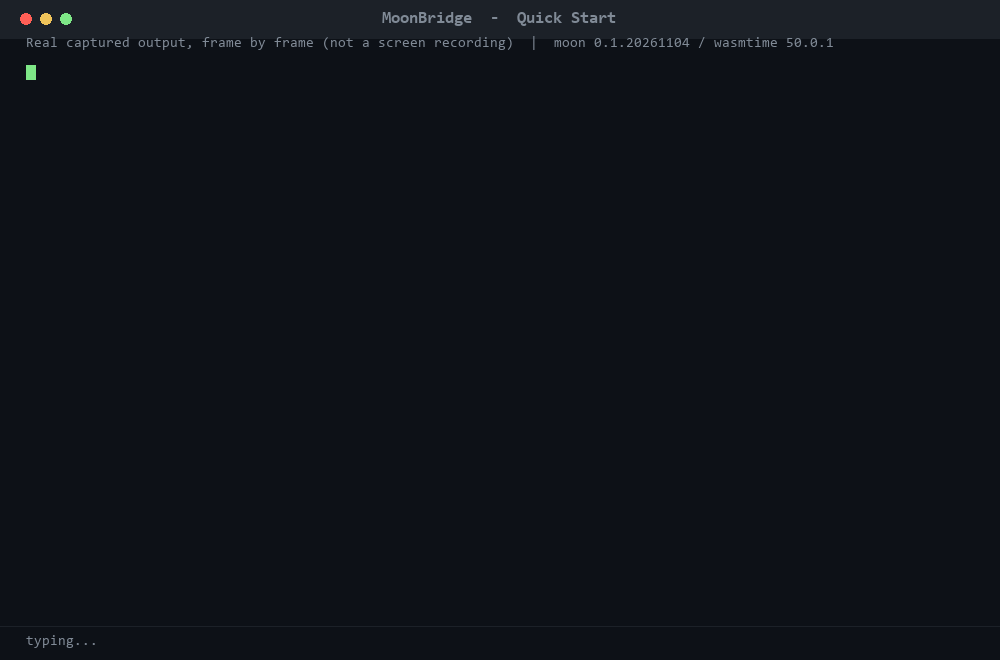

# MoonBridge

[](https://mooncakes.io/docs/gyyyy6/moonbridge)

**把 MoonBit 模块变成可 `pip install` 的 Python 包。**

给一个 `moon.mod`，MoonBridge 读取它的公开接口（`moon info` 产物），生成一个真正的 Python
包：模块、类、枚举、异常、`.pyi` 类型存根、docstring，加上 MoonBit 侧的运行时（句柄表 +
稳定宿主 ABI），最后打成 wheel。

```text
moon.mod  ──moon info──▶  接口 IR  ──typemap──▶  代码生成  ──▶  wheel
                                                        │
                                          MoonBit 运行时（句柄/ABI）
                                                        │
                                            wasm 模块 / native 库
```

## Quick Start

三条命令，从零到调用一个真实的 MoonBit 函数。**只要 Python 3.9+**：不需要懂 wasm、
不需要装 MoonBit 或 C 工具链、不需要配置任何路径；`wasmtime` 由 `pip` 自动带上。

先在**仓库根目录**建一个干净的虚拟环境（推荐：保证下面三条命令无缓存、无多余依赖）：

```bash
python -m venv .venv
# Windows PowerShell → .\.venv\Scripts\Activate.ps1
# Windows cmd        → .venv\Scripts\activate.bat
# macOS / Linux      → source .venv/bin/activate
```

然后复制粘贴这 3 条命令（Windows / macOS / Linux 通用；除 Python 3.9+ 和首次联网外，
不需要安装任何额外软件、工具链或依赖）：

```bash
python -m pip install ./dist/moonbridge-0.1.0-py3-none-any.whl

python -c "import moonbridge; moonbridge.install(); from moonbridge import moonbitlang__core__json as m; print('valid:', m.valid('[1, 2, 3]'))"

python scripts/wheel_smoke.py
```

预期 `valid: True`，随后 11 项自检全部 `ok`、末行 `wheel installed and functional`。
`moonbridge.install()` 会加载 wheel 内置的 wasm guest；第 3 步依次验证 JSON 往返、
对象构造与字段读写、`list` / `dict` / `lambda` 跨边界、类型化异常，以及结束时句柄归零。
首次安装需要联网一次（拉取 `wasmtime`）。

**👉 [完整保姆级使用手册（点我）](docs/usage-guide.md)** —— 面向完全不懂 MoonBit 的 Python 开发者：环境准备（Windows/macOS/Linux）、安装 / 导入 / 调用 / 异常处理、把**自己的** MoonBit 库变成 Python 包、以及 5 个常见坑的解法。



> 动画里的输出取自干净 venv 的真实执行结果，只有 venv 的绝对路径缩写为 `<venv>/...`。
> 完整可复现链路是 `bash scripts/e2e.sh`，打包细节见 [S6 打包](docs/s6-wheel.md)。

## 安装

MoonBridge 以两种形态分发：

- **MoonBit 模块**（已发布到 mooncakes.io）：`moon add gyyyy6/moonbridge`
  包页：<https://mooncakes.io/docs/gyyyy6/moonbridge> ｜ 版本 `0.1.0` ｜ Apache-2.0。
- **Python wheel**：`pip install ./dist/moonbridge-0.1.0-py3-none-any.whl`（见上方 Quick Start）。
  预编译的 wheel **随仓库一起提交**，克隆下来即可安装，不需要 MoonBit 工具链；
  想从源码重建用 `bash scripts/e2e.sh`。完整用法见 [用户手册](docs/usage-guide.md)。

发布实测：`moon publish --dry-run` 返回 `202 Accepted`、`moon publish` 返回 `200 OK`；
`moon search "gyyyy6/moonbridge"` 可见 `gyyyy6/moonbridge@0.1.0`，
在一个独立的临时模块中执行 `moon add gyyyy6/moonbridge` 已成功解析到 `@0.1.0`。

> 状态：**S0 通过、S1 通过、S2 通过、S3 通过、S4 通过、S5 通过、S6 通过**（2026-11-06）。
> S0：调用 ABI、内存共享、宿主↔MoonBit 字节流、UTF-8 往返全部跑通，实测见
> [spikes/01-wasm-python](spikes/01-wasm-python/)。
> S1：`.mbti` 解析器 + 类型图，在 **501 个真实接口文件 / 17,793 条声明**上 100% 通过，
> 见 [S1 语料报告](docs/s1-corpus-report.md)。
> S2：类型映射 + Python 代码生成，**501 个包生成 stub，`mypy --strict` 0 报错**，
> 见 [S2 映射与生成](docs/s2-type-mapping.md)。
> S3：跨包句柄与生命周期，**真实 json 包端到端跑通，10 万次调用 0 泄漏、guest 内存逐字节不变**，
> 见 [S3 运行时](docs/s3-runtime.md)。
> S4：**guest 侧也由生成器产出**，对象能被构造、读、写；10 万次 × 6 个用例共 150 万帧，
> 内存曲线平直、`live=0`、`dropped=0`，见 [S4 对象模型](docs/s4-object-model.md)。
> S5：`Array` / `Map` / `Option` / `Result` / 回调 / 异常字段全部可跨边界——Python 的 `list`、
> `dict`、`lambda` 直接传，MoonBit 的 `suberror` 变成 Python 的 `except` 类，
> 见 [S5 容器与回调](docs/s5-containers-and-callbacks.md)。
> S6：**打成真正的 wheel**——607 KB，567 个条目，`requires = []` 的自写 PEP 517 后端，
> 可复现构建；`pip install` 之后 `import moonbridge; moonbridge.install()` 即可用，
> 见 [S6 打包](docs/s6-wheel.md)。
> **批量协议（2026-11-13）**：`mb_call_batch` 一次跨越跑 N 帧，10 万次 `valid()`
> 从 **40.34 μs/次降到 6.87 μs/次（5.87×）**，跨越次数 100,000 → 391，
> 171/171 测试与 10 万次 0 泄漏不回退，见 [批量协议报告](docs/batching.md)。

> **开发复盘与「AI 可解释」证据索引**：[docs/development-retrospective.md](docs/development-retrospective.md) —
> 关键架构决策（wasm 优先、Plan 模型）、AI 工具在开发流程中的角色，以及
> 「每一个技术选择该翻哪个文件、跑哪条命令才能解释」的对照表。

---

## 为什么要做这个

MoonBit 已经能编译到 wasm / wasm-gc / js / native，但**别的语言调用 MoonBit 仍然要靠手写胶水**。
生态里现有的跨语言能力是零散的：

| 目标语言 | 现有方案 | 形态 |
| --- | --- | --- |
| Node.js | `unmbt/napi-mbt` | 生成 Node-API 绑定（仅 Node） |
| Java / Android | `Nanaloveyuki/ajni` | JNI 双向运行时（仅 Java） |
| C | `icyaaaww/moonbind` | 从 C 头文件生成 MoonBit 绑定（**反方向**） |
| TypeScript | `mizchi/ts` | TS ↔ MoonBit 桥接 |
| **Python** | **无** | — |
| **Go / Rust / Swift / PHP** | **无** | — |

MoonBridge 补的是这一层：**不是给某个库手写一层包装，而是把"跨语言绑定"本身做成编译器式的生成器**。
增量不在"又一个包装库"，而在：

1. **通用性**：任意 MoonBit 模块一条命令生成，不是一次性胶水；
2. **所有权协议**：GC 托管对象通过句柄表跨越边界，宿主永远不会拿到悬垂指针；
3. **类型保真**：MoonBit 的 `enum` / `Option` / `Result` / 泛型映射成 Python 侧有类型的对象，
   而不是 `dict` 与 `Any`；
4. **可安装**：产出符合 PEP 517 的 wheel，`pip install` 即用，不需要用户懂 wasm。

---

## Spike 01 结论（已验证）

| 验证项 | 结果 |
| --- | --- |
| `#export_name` 导出 | `mb_add` / `mb_fib` / 缓冲与字符串函数全部可见 |
| 线性内存导出 | 需 `options(link: {"wasm": {"export-memory-name": "memory"}})` |
| 参数表示 | `String` / `Bytes` 参数是**单个 i32 对象指针** → 必须走句柄协议 |
| 宿主写入 → MoonBit 读 | 写 16 字节，MoonBit 校验和 1626 一致 |
| MoonBit 写 → 宿主读 | 读回 `b'AAAAAAAA'` |
| UTF-8 往返 | `你好, MoonBit 🚀` → 13 个码位 / 20 字节，往返字节一致 |
| 每次调用开销 | 本机 wasmtime-py 基线：`nop` 6.9 μs，单参 16.6 μs；MoonBit `add` 22.7 μs |

最后一行决定了架构：**瓶颈在 Python 绑定层，不在 MoonBit**。因此高频路径必须走
"批量调用 + 缓冲协议"（一次跨越处理 N 个元素），并且 native(C ABI) 后端要作为性能选项保留。
**该批量协议已于 2026-11-13 实现并验证**：10 万次 `valid()` 从 40.34 μs/次降到
6.87 μs/次（**5.87×**），跨越次数 100,000 → 391，详见 [批量协议报告](docs/batching.md)。
决策依据见 [ADR 0001](docs/decisions/0001-wasm-first.md)。

---

## S1：接口解析与类型图

`moon info` 输出的 `.mbti` 是纯文本接口，但它是**生成的**、且随工具链版本演进的。
MoonBridge 用一个手写递归下降解析器把它读成 AST，再建成类型图：

```text
.mbti  ──lexer──▶ token ──parser──▶ AST ──graph──▶ 类型图
                                                  │
                                     依赖顺序 / 互递归组 / 外部类型
```

```bash
# 解析若干接口文件，逐文件汇报，任一失败则退出码非 0
moon run --target js src/cli -- path/to/pkg.generated.mbti ...

# 跑真实语料（标准库 + 20 个已发布模块及其依赖）
bash scripts/corpus.sh all
```

已覆盖的语法（全部由真实语料逼出来，明细见
[S1 语料报告](docs/s1-corpus-report.md#语料逼出来的语法缺口)）：泛型与 trait 约束、
函数类型、`T??`、`&Trait`、`async fn`、`raise` / `raise E` / `noraise` / `nocancel`
及其 `+` 组合、`pub(all)` / `pub(open)` / `priv`、`mut` 字段、构造器标签字段、
`const` 字面量、`type X = Y` 别名、重导出块、旧式 `import( … )` 块。

类型图回答三个生成器必需的问题：**先发哪个类型**（`topo_order`）、
**哪些类型互相递归必须一起产**（`cycles`，Tarjan SCC）、
**哪些类型不在本包**（`external_names`，交给宿主类型表）。

## S2：类型映射与 Python 代码生成

解析出的类型图要变成 Python 能理解的东西，中间要过两道关：**类型映射**（MoonBit 类型
→ Python 注解）和**命名**（MoonBit 标识符 → 合法且不遮蔽的 Python 标识符）。

```text
AST  ──typemap──▶ PyType ──render──▶ .pyi
      │                              │
   降级阶梯（4 级，每级都记账）        mypy --strict 校验
```

```bash
# 全语料生成 + mypy strict（需要 python + mypy）
bash scripts/gen.sh all
bash scripts/gen.sh core    # 仅标准库，离线可跑
```

映射结果只有四种，按保真度从高到低：**直接对应**（`Int`→`int`）、**透明擦除**
（`&T`、`T??`）、**句柄**（包内类型 → 生成类，值留在 MoonBit 堆上，跨边界的是不透明整数）、
**降级为 `Any`**。第四级从不静默：每个 `Any` 都带一条原因记录，`--gen` 按原因汇总：

```text
stubs=501 failed=0 types=1937 funcs=4789 fields=3733 skipped=7
degraded: foreign=4812 unknown=890 result=130 higher-order=699 arity=0 async=81
```

（S2 当时的数字。S3 引入世界索引后 `foreign` 降到 605、`unknown` 降到 255。）

两处刻意的选择：函数类型降级为 `Any` 而**不是** `Callable`（没有回调蹦床，写 `Callable`
等于承诺一条走不通的路）；stub 之间**互不 import**（MoonBit 包图含 48 个环，跨包类型走 `Any`，
保证每个 `.pyi` 独立可检查）。完整映射表、命名规则、以及 mypy 逼出来的六类问题见
[S2 映射与生成](docs/s2-type-mapping.md)。

## S3：跨包句柄与运行时

前两段产出的是一份"说得对"的接口。这一段让它能真的调起来：跨包导入补上、句柄表跑起来、
wasmtime 接进来，然后拿真实的 `moonbitlang/core/json` 验一遍。

```text
.mbti ──▶ stub(.pyi)   类型检查器读的那一份
     └──▶ module(.py)  解释器执行的那一份   ┐
                                            ├─ 同一次遍历，签名不可能与函数体不符
     世界索引 ──▶ from . import <stem>       ┘
                                            │
     Python 对象 ──handle id──▶ 句柄表 ──▶ MoonBit 堆 ──▶ wasm guest
                    ◀──批量回收 / close() / with──┘
```

```bash
# 生成 + 端到端 + 10 万次调用基准，任一泄漏即退出码非 0
bash scripts/e2e.sh
```

三个数字说明这一段到底做了什么：

| | S2 | S3 |
|---|---|---|
| 跨包类型降级为 `Any` | 4812 处 | **605 处**（剩下的真的不在语料里） |
| 生成的模块间导入边 | 0 | **566**（276 个模块） |
| 10 万次调用的 guest 内存 | — | **64 KiB 不变**，句柄表归零 |

基准还抓到了三个都不报错、只体现在曲线上的 bug：0 号句柄被当成"没有对象"（第一份文档永不释放）、
导出函数的返回值泄漏（41 字节/次）、世代计数器回绕（每 1023 次漏一个）。三个都写进
[S3 运行时](docs/s3-runtime.md)，包括怎么二分定位的。

## S4：生成 guest 与对象模型

S3 的绑定只有一半是生成的：`.py` / `.pyi` 从接口推出来，**guest 的 dispatch 表是手写的**。
手写的表会漂——它不会因为编译失败被发现，只会在某次调用悄悄返回错的字段。S4 把这个缺口补上：

```text
                    ┌──────────── Plan ─────────────┐
.mbti ──▶ World ──▶ │ Sym[]        符号/形状/标签    │ ──┬──▶ .py / .pyi   调用方
 (S1)     (S3)      │ HandleSlot[] 每类型一张句柄表   │   └──▶ guest.mbt    应答方
                    └───────────────────────────────┘
```

一份计划，两半投影，**两半不可能不一致**。顺带把"看得见"变成"用得上"：生成的类现在真的能
`Position(3, 7)`、读 `line`、写 `cursor`。

| | S3 | S4 |
|---|---|---|
| guest 侧 dispatch | 手写 270 行 | **生成 1161 行**（`--guest` / `--guest-out`） |
| 句柄表 | 手写 12 张 | **按用到的具体类型生成** |
| 生成类的可调用成员 | 只有方法 | 方法 + `__init__` + `@property` + setter |
| 端到端断言 | 调通 + 释放 | 构造、读、写、句柄实参、`dropped=0` |
| 10 万次基准 | 4 个用例 | 6 个用例，150 万帧，内存平直 |

验收又抓到一个不报错的泄漏：`parse` 返回 `Json` 的句柄，而 `Json` 是 **enum**，
`render_enum` 从来没写 `moon_type_id`——`close()` 发出 `release_tag(0, id)`，guest 里没有 tag 0 的表，
**什么都没释放**，Python 侧却把这次释放算成功。只有 `Runtime.dropped` 看得见它。
细节见 [S4 对象模型](docs/s4-object-model.md)。

## S5：容器、回调与异常

到 S4 为止，能调的函数都是**标量函数**：`Array`、`Map`、`Option`、`Result`、函数值全在
`unmarshalable-param` 这一格里。S5 把这一格清掉，Python 侧不需要任何新类型：

```python
Json.array([Json.number(1.0), Json.string("two")])   # list -> Array[Json]
Json.object_({"a": Json.number(1.0)})                # dict -> Map[String, Json]
mcb.call_with(lambda x: x + 2, 40)                   # callable -> Int32 id
try: mjson.parse("{oops")
except mjson.ParseError as exc: ...                  # suberror -> except 类
```

回调是这里唯一需要新机制的东西：wire 上只有一个 `Int32` id，guest 通过 **wasm import**
回头调用宿主，所以回调发生在 guest 栈上——没有协程、没有重放、没有第二个线程。

| | S4 | S5 |
|---|---|---|
| wire 形状 | 8 个标量 | 递归树（`WArr` / `WMap` / `WRes` / `WCall`） |
| guest 符号 | 49 | **54** |
| `unmarshalable-param` | 15 | **14** |
| 端到端断言 | 29 | **42** |

验收抓到的是一类"只在重新生成之后才红"的 bug：`Option[T]` 的解码器就是 `T` 的解码器，
于是按名字去重时 `WMaybe(WInt)` 会把 `dec_int` 这个名字占住却什么都不写，真正的报错出现在
生成物的 `dec_int is unbound`。名字和形状不是一对一，这一课写在
[S5 容器与回调](docs/s5-containers-and-callbacks.md) 里，连同"回调通道被建立 ≠ 通得过"
（`debug_assert` 在 release 下被编译掉，实测 0 次调用）一起。

## S6：wheel

前五个阶段的产物是"能跑的一堆文件"。S6 的验收只有一句：

```bash
pip install ./dist/moonbridge-0.1.0-py3-none-any.whl
python -c "import moonbridge; moonbridge.install()"
```

构建系统是自己写的 128 行 PEP 517 后端，`requires = []`——用户不必为了装这个包先装
setuptools，断网也能构建。wheel 里是可移植的 wasm 与 553 个 `.pyi`，`Tag: py3-none-any`
由 `Requires-Dist: wasmtime>=20` 兜住平台差异。

| | S5 | S6 |
|---|---|---|
| 分发形态 | `_gen/` 一个目录 | **`moonbridge-0.1.0-py3-none-any.whl`**（607 KB / 567 条目） |
| 构建依赖 | — | **0**（标准库） |
| 构建可复现 | — | 两次构建 sha256 相同，且与 pip 驱动后端的结果相同 |
| 安装后的初始化 | 传 wasm 路径 | `moonbridge.install()` |
| 安装后功能断言 | — | 11 项全绿，`live=0` |

打包脚本最小心的地方是**从仓库外跑冒烟测试**：在仓库根目录 `import moonbridge` 会找到
`_gen/`，wheel 少一个文件也照样"通过"。细节见 [S6 打包](docs/s6-wheel.md)。

## 批量协议（Batching）：一次跨越处理 N 次调用

S0 测出单次往返 6.9–22.7 μs，[ADR 0001](docs/decisions/0001-wasm-first.md) 因此要求
"hot path 一律批量"，但当时只写了计划。这一段把它兑现：新增一个 wasm 导出
`mb_call_batch`，把 N 帧打包进**一次**宿主跨越——N 次调用摊薄成一次 wasm 调用、
一次内存写、一次内存读。

```text
旧：for x in xs: mjson.valid(x)    →  N × (encode + wasm call + read + decode)
新：mjson.valid_many([(x,) ...])   →  1 × (encode N + wasm call + read + decode N)
```

生成器为每个**可批量**的函数自动产出 `<fn>_many`（可批量 = 全位置参数、且参数里没有函数值；
labelled / optional 参数或回调在元组里没有无歧义的位置，仍走单次调用）。
低层入口是 `moonbridge.run_batch(symbol, calls, wrap=...)`，供自定义批量使用。

```python
import moonbridge
from moonbridge import moonbitlang__core__json as mjson

moonbridge.install()
mjson.valid_many([('{"a": 1}',), ("{oops",), ("[]",)])   # [True, False, True]
```

### 10 万次实测（Windows 11 / Python 3.13 / wasmtime 50.0.1，batch size 256）

| 模式 | 总耗时 | 每次调用 | 宿主跨越次数 |
| --- | --- | --- | --- |
| 循环单次调用 `valid()` × 100,000 | 4.034 s | **40.34 μs** | 100,000 |
| `valid_many` 批量 × 100,000 | 0.687 s | **6.87 μs** | **391** |
| **加速比** | | **5.87×** | **256× 更少的跨越** |

同一测量重跑 3 次：5.87× / 5.89× / 5.97×（中位数 **5.89×**）。6.87 μs 已落到 S0 的
纯 wasm `nop` 基线（6.9 μs）附近——剩下基本是 MoonBit 自己执行 `valid` 的成本，
绑定层被摊薄到接近零。

### 不变量没有被牺牲

- `moon test --deny-warn` **171/171**（wasm + js 双目标）、`moon fmt --check`、
  `mypy --strict`（561 个生成 stub，0 报错）、`reuse lint` 77/77 全绿。
- 原有 6 个 10 万次用例的句柄与内存曲线逐字节不变：`live=0`、`dropped=0`、
  guest 内存平直（192 / 384 KiB）。
- 批量路径额外断言：返回句柄的批量调用全部 `close()` 后 `live=0`；**在一批中间插入一个
  `ParseError`** 仍能抛出类型化异常且 `live=0`。guest 会把整批跑完，失败帧之后的成功帧
  也会造句柄，所以 fail-fast 必须先给所有成功帧建立 Python 所有者再统一释放——这个坑是
  实测抓到的，已固化成基准断言。

三方向的评估依据、字节级帧格式、生成规则与已知边界见
**[批量协议报告](docs/batching.md)**；决策依据见 [ADR 0001](docs/decisions/0001-wasm-first.md)。

## 开发

```bash
# MoonBit 侧
moon check --deny-warn
moon test  --deny-warn
moon fmt --check

# 语料（core 子集离线可跑；all 需要网络）
bash scripts/corpus.sh core
bash scripts/corpus.sh all

# 生成 Python stub 并跑 mypy strict
bash scripts/gen.sh all

# 生成 + 端到端 + 10 万次基准（含单次 vs 批量对比；需要 python + wasmtime）
bash scripts/e2e.sh
BENCH_CALLS=20000 bash scripts/e2e.sh   # 快速跑一遍

# 只打包：构建 wheel、装进临时 venv、从仓库外冒烟测试
bash scripts/wheel.sh
bash scripts/wheel.sh --keep-venv       # 留着 venv 检查

# Spike 复现（需要 Python 3.10+ 与 wasmtime）
cd spikes/01-wasm-python/module && moon build --target wasm && cd ..
python bridge_test.py
```

> CLI 目前在 js 后端运行（唯一不依赖 C 工具链的后端），文件读取只有一处
> `extern "js"`，其余代码与目标无关。

工具链：MoonBit `0.1.20261023`（moonc `0.10.17`）/ Python 3.13 / wasmtime 50.0.1。

---

## 路线图

- [x] **S0** 宿主 ABI 可行性：wasm 导出、内存共享、UTF-8 往返
- [x] **S1** 接口 IR：解析 `moon info`，覆盖 struct / enum / 泛型 / trait / 别名
      （501 个真实接口文件 100% 通过，见 [报告](docs/s1-corpus-report.md)）
- [x] **S2** 类型映射与代码生成：501 个包生成 `.pyi`，`mypy --strict` 0 报错
      （见 [报告](docs/s2-type-mapping.md)）
- [x] **S3** 跨包句柄与生命周期：真实 json 包端到端可调，10 万次往返 0 泄漏、内存不涨
      （见 [报告](docs/s3-runtime.md)）
- [x] **S4** 生成 guest 与对象模型：dispatch 表与句柄表由计划产出，对象可构造/读/写，
      10 万次 × 6 用例 150 万帧 0 泄漏（见 [报告](docs/s4-object-model.md)）
- [x] **S5** 容器、回调与异常字段：`Array` / `Map` / `Option` / `Result` / `Callable` 全部可跨边界，
      `suberror` 变成 Python 异常类（见 [报告](docs/s5-containers-and-callbacks.md)）
- [x] **S6** PEP 517 打包与真实包端到端：自写构建后端（零依赖、可复现），
      `pip install` 后 `import moonbridge` 即可用（见 [报告](docs/s6-wheel.md)）
- [x] **批量协议（Batching）**：`mb_call_batch` + 自动生成的 `*_many` + `run_batch`；
      10 万次 `valid()` **5.87× 加速**（40.34 → 6.87 μs/次），0 泄漏
      （见 [报告](docs/batching.md)；兑现 ADR 0001 第 2 条）
- [ ] **S7** native(C ABI) 后端、文档站（CI 双目标矩阵与 REUSE 合规已在 S6 后补齐）

---

## 与现有生态的关系

MoonBridge 不重新实现任何已有能力：JSON、CSV、正则、压缩等一律复用 mooncakes 上的包，
它只负责**把它们的接口翻译到 Python**。如果你在找一个 JSON 查询引擎，请用
`moonbit-community/moonbit-jq`；MoonBridge 的价值在于让那类库能被 Python 直接调用。

---

## 许可证

Apache-2.0，见 [LICENSE](LICENSE)。
